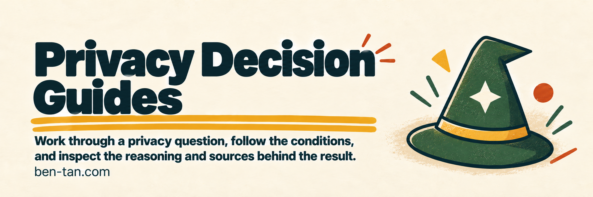

# Privacy Decision Guides

Work through a privacy question, follow the conditions, and inspect the reasoning and sources behind the result.

<p>
<a href="https://ben-tan.com/tools/privacy-decisions/"></a>&nbsp; 
<a href="LICENSE"></a>&nbsp; 
<a href="https://ko-fi.com/itsbent"><picture><source media="(prefers-reduced-motion: reduce)" srcset="docs/images/buttons/kofi-static.svg"></picture></a>&nbsp; 
</p>

[](docs/images/banner.png)

*[Open at ben-tan.com](https://ben-tan.com/tools/privacy-decisions/).*

## What it does

Eighteen guides cover questions about applicable laws, impact assessments, transfers, privacy rights, breaches, and AI systems. Open **Why this question?** to see the explanation and sources while answering.

Answers stay in the current tab. Sources missing or marked draft or superseded are blocked. You can copy the result and its source links for further review.

## Run locally

Use Node.js 22.12 or newer. No sibling checkout or cloud service is required.

```sh
npm ci --ignore-scripts --prefix packages/privacy-guides
npm run build
npm start
```

Open [the local guides](http://127.0.0.1:8903/tools/privacy-guides/). Set `PORT` to select another port. The local source route retains its original name; the [public guides](https://ben-tan.com/tools/privacy-decisions/) use the current product name. The preview includes this tool, not the surrounding website's other pages.

## Build and check

```sh
npm test
npm run build
node scripts/verify-site.mjs
```

`packages/privacy-guides/` holds the source package and legal-source records. `integrations/privacy-guides/` holds interface adaptations. Changes must preserve decision IDs, source bodies, citations, numeric rules, and eligibility; the builder verifies reviewed source and runtime pins.

## Limitations

These guides are decision aids, not legal advice. Check each guide's scope, dates, assumptions, and source qualifications. A citation does not establish that a guide covers your situation or that the law is unchanged.

## License and credits

Code uses the [MIT license](LICENSE), including the original Privacy Wizards Council attribution. Retain cited-source attribution and bundled third-party notices. The code license does not relicense cited texts or third-party artwork.

---

Made by [Ben Tan](https://ben-tan.com). [Report a security issue](SECURITY.md).
